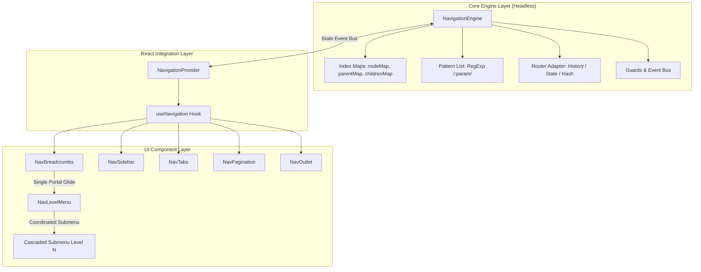

# Navigation Subsystem: Architecture, API & Usage Guide

The Consona Interface Navigation Subsystem provides a high-performance, tree-structured routing architecture with bidirectional browser history synchronization, reactive hooks, kinetic gliding breadcrumbs, single-portal coordinated cascading menus, and zero-flicker view mounting.

---

## 1. System Architecture & Topology

The subsystem is organized in three decoupled layers:
1. **Core Engine Layer**: A pure, framework-agnostic TypeScript class (`NavigationEngine`) managing the routing graph, fast index maps ($O(1)$ lookups), regex pattern compilation, and history state.
2. **Context & Bridge Layer**: React context (`NavigationProvider`) and headless hook (`useNavigation()`) synchronizing engine events into reactive React state.
3. **UI Component Layer**: Visual primitives (`NavBreadcrumbs`, `NavLevelMenu`, `NavSidebar`, `NavTabs`, `NavPagination`, `NavOutlet`) engineered for fluidity, micro-interactions, and accessibility.



---

## 2. Kernel Engine: `NavigationEngine`

`NavigationEngine` is a headless coordinator with zero external UI dependencies.

### 2.1 Class Anatomy & State Model

```typescript
export interface NavigationState<TData = any> {
  /** Active node ID */
  activeId: string
  /** Active node object */
  activeNode: NavNode<TData> | null
  /** Current URL path */
  currentPath: string
  /** Computed hierarchical trail from root to active node */
  trail: NavTrailStep<TData>[]
  /** Extracted dynamic URL parameters (e.g. { category: 'buttons', id: 'primary-btn' }) */
  params: Record<string, string>
  /** Parsed URL query parameters (e.g. { tab: 'preview', q: 'search' }) */
  query: Record<string, string>
  /** Custom state payload attached to the navigation */
  state: any
  /** Current position in history */
  historyIndex: number
  /** Total number of indexed nodes in the tree */
  totalNodes: number
}
```

### 2.2 Indexing & $O(1)$ Trail Resolution

When a tree is passed to `setTree(nodes)`:
1. **Node Map** (`nodeMap: Map<string, NavNode>`): Provides $O(1)$ lookup by ID or path.
2. **Parent Map** (`parentMap: Map<string, string | undefined>`): Tracks parent lineage for trail resolution.
3. **Children Map** (`childrenMap: Map<string, NavNode[]>`): Instant access to child routes.
4. **Pattern List** (`patternList: Array<{ regex: RegExp, keys: string[], node: NavNode }>`): Parameterized routes like `/components/:category/:id` are compiled into regex matches with named capture groups.

```typescript
// Trail resolution climbs parents in O(log N) operations:
private buildTrail(leafNode: NavNode<TData>): NavTrailStep<TData>[] {
  const trail: NavTrailStep<TData>[] = []
  let curr: NavNode<TData> | undefined = leafNode
  let depth = 0

  while (curr) {
    const parentId = this.parentMap.get(curr.id)
    const siblings = parentId ? (this.childrenMap.get(parentId) || []) : this.tree
    const children = this.childrenMap.get(curr.id) || curr.children || []

    trail.unshift({
      node: curr,
      depth,
      isCurrent: curr.id === leafNode.id,
      siblings,
      children,
    })

    curr = parentId ? this.nodeMap.get(parentId) : undefined
    depth++
  }

  return trail
}
```

### 2.3 Native Browser History & Trackpad Gesture Synchronization

To support native trackpad swipe gestures (three-finger or two-finger back/forward swipe) and the browser address bar, the engine integrates via a `NavRouterAdapter`:

```typescript
// State synchronization with popstate
window.addEventListener('popstate', (event) => {
  const currentPath = window.location.pathname
  this.syncFromExternal(currentPath, event.state)
})
```

---

## 3. React Integration: `NavigationProvider`

The `NavigationProvider` wraps your application, managing engine lifecycle, controlled/uncontrolled active ID binding, and event propagation.

### 3.1 Provider Configuration

```tsx
import { NavigationProvider } from '@consona/interface'
import { appNavTree } from './nav-tree'

export function App() {
  return (
    <NavigationProvider
      tree={appNavTree}
      defaultId="dashboard"
      onNavigate={(node, options) => {
        console.log(`Navigated to ${node.title} (${node.href})`, options)
      }}
    >
      <MainLayout />
    </NavigationProvider>
  )
}
```

### 3.2 Props Interface

| Prop | Type | Default | Description |
| :--- | :--- | :--- | :--- |
| `tree` | `NavTree` | `[]` | Hierarchical navigation tree. |
| `activeId` | `string` | `undefined` | Controlled active node ID. |
| `defaultId` | `string` | `tree[0]?.id` | Initial node ID for uncontrolled mode. |
| `adapter` | `NavRouterAdapter` | `StateRouterAdapter` | Router adapter (state, browser history, or custom). |
| `engine` | `NavigationEngine` | `undefined` | Custom pre-instantiated engine instance. |
| `onNavigate` | `(node, opts) => void` | `undefined` | Global callback triggered after every successful route change. |

---

## 4. Headless Hook: `useNavigation()`

The `useNavigation()` hook gives any React component access to active state, lineage data, and imperative navigation methods.

### 4.1 Hook Return Structure

```typescript
export interface UseNavigationReturn<TData = any> extends NavigationState<TData> {
  /** Programmatically navigate to target node ID or path */
  navigate: (target: string | NavNode<TData>, options?: NavigationOptions<TData>) => Promise<boolean>
  /** Navigates back in browser history */
  back: () => void
  /** Navigates forward in browser history */
  forward: () => void
  /** Resolves the complete trail for any node ID */
  getTrail: (id: string) => NavTrailStep<TData>[]
  /** Retrieves children of a given node */
  getChildren: (id: string) => NavNode<TData>[]
  /** Retrieves siblings of a given node */
  getSiblings: (id: string) => NavNode<TData>[]
  /** Raw NavigationEngine instance */
  engine: NavigationEngine<TData>
}
```

### 4.2 Hook Usage Example

```tsx
import React from 'react'
import { useNavigation } from '@consona/interface'

export function UserProfileHeader() {
  const { activeNode, trail, params, navigate, back } = useNavigation()

  return (
    <div className="flex items-center justify-between p-4 border-b">
      <div>
        <h1 className="text-lg font-bold">{activeNode?.title}</h1>
        <p className="text-xs text-muted-foreground">User ID: {params.userId}</p>
      </div>

      <div className="flex items-center gap-2">
        <button onClick={() => back()} className="btn btn-secondary">
          Go Back
        </button>
        <button
          onClick={() => navigate('/settings/profile')}
          className="btn btn-primary"
        >
          Edit Profile
        </button>
      </div>
    </div>
  )
}
```

---

## 5. UI Primitives & Motion Physics

### 5.1 `NavBreadcrumbs` (Kinetic Gliding Flyouts)

`NavBreadcrumbs` renders a trail with floating level menus.
- **Single Portal Gliding**: Instead of mounting multiple independent menus, one shared floating card is rendered via `createPortal(..., document.body)` with `position: fixed`.
- **Viewport Boundary Clamping**: Automatically detects screen edges and aligns smoothly beneath the active pill or separator.
- **`ResizeObserver` Dimension Morphing**: When switching between levels with differing item counts, width and height morph smoothly with spring physics.

```tsx
<NavBreadcrumbs
  separator="chevron"
  enableHoverMenus={true}
  enableForwardMenus={true}
  trigger="hover"
  openDelayMs={80}
  closeDelayMs={200}
/>
```

### 5.2 `NavLevelMenu` (Single Coordinated Cascading Submenus)

`NavLevelMenu` lists sibling options, categories, and child sub-routes.
- **Coordinated Single Cascading Submenu**: Hovering over menu rows opens child submenus within **one portal container per depth level**, preventing portal stacking and DOM thrashing.
- **Search Isolation**: Built-in search filter input blocks mouse/keyboard propagation so typing or clearing text never dismisses the menu.

### 5.3 `NavOutlet` (Reactive Viewport Router)

Renders the active route's mapped component or executes custom render logic:

```tsx
<main className="flex-1 p-6">
  <NavOutlet fallback={<div className="p-8 text-muted-fg">404: Page not found.</div>} />
</main>
```

---

## 6. Real-World Production Recipes

### Recipe 1: Complete Application Root Setup

```tsx
import React from 'react'
import {
  NavigationProvider,
  NavBreadcrumbs,
  NavSidebar,
  NavOutlet,
  type NavTree,
} from '@consona/interface'
import { LayoutDashboard, Users, Settings, FolderTree } from 'lucide-react'

// 1. Define Hierarchical Navigation Tree
const appNavTree: NavTree = [
  {
    id: 'dashboard',
    title: 'Dashboard',
    href: '/dashboard',
    icon: LayoutDashboard,
    component: DashboardView,
  },
  {
    id: 'projects-hub',
    title: 'Projects',
    href: '/projects',
    icon: FolderTree,
    component: ProjectsListView,
    children: [
      {
        id: 'project-detail',
        title: 'Project Details',
        pattern: '/projects/:projectId',
        component: ProjectDetailView,
        hideInNav: true,
      },
    ],
  },
  {
    id: 'team',
    title: 'Team Members',
    href: '/team',
    icon: Users,
    component: TeamView,
  },
  {
    id: 'settings',
    title: 'Settings',
    href: '/settings',
    icon: Settings,
    component: SettingsView,
  },
]

// 2. Main App Shell
export function AppShell() {
  return (
    <NavigationProvider tree={appNavTree} defaultId="dashboard">
      <div className="flex h-screen w-screen overflow-hidden bg-background text-foreground">
        {/* Left Sidebar */}
        <aside className="w-64 border-r border-border p-3 flex flex-col">
          <div className="font-bold text-sm px-3 py-2">Enterprise App</div>
          <NavSidebar className="flex-1 mt-2" />
        </aside>

        {/* Right Content Area */}
        <div className="flex-1 flex flex-col overflow-hidden">
          {/* Topbar with Gliding Breadcrumbs */}
          <header className="h-12 border-b border-border px-4 flex items-center justify-between">
            <NavBreadcrumbs separator="chevron" enableHoverMenus enableForwardMenus />
          </header>

          {/* Dynamic Router Viewport */}
          <main className="flex-1 overflow-y-auto p-6">
            <NavOutlet />
          </main>
        </div>
      </div>
    </NavigationProvider>
  )
}
```

---

### Recipe 2: Dynamic Pattern Routing with Parameters

```tsx
import React from 'react'
import { useNavigation } from '@consona/interface'

export function ProjectDetailView() {
  const { params, query, navigate } = useNavigation()
  const { projectId } = params // Automatically extracted from /projects/:projectId

  return (
    <div className="space-y-4">
      <h2 className="text-xl font-bold">Project: {projectId}</h2>
      <p className="text-sm text-muted-foreground">Active Tab: {query.tab || 'overview'}</p>

      <div className="flex gap-2">
        <button
          onClick={() => navigate(`/projects/${projectId}?tab=tasks`)}
          className="btn btn-sm"
        >
          View Tasks
        </button>
        <button
          onClick={() => navigate(`/projects/${projectId}?tab=members`)}
          className="btn btn-sm"
        >
          View Members
        </button>
      </div>
    </div>
  )
}
```

---

### Recipe 3: Command Palette / Quick Search Modal via `useNavigation`

```tsx
import React, { useState } from 'react'
import { useNavigation, type NavNode } from '@consona/interface'
import { Search } from 'lucide-react'

export function CommandPaletteDialog({ open, onClose }: { open: boolean; onClose: () => void }) {
  const { engine, navigate } = useNavigation()
  const [query, setQuery] = useState('')

  if (!open) return null

  // Flattened search index
  const allNodes = Array.from((engine as any).nodeMap.values()) as NavNode[]
  const filtered = allNodes.filter(
    (node) =>
      !node.hideInNav &&
      (node.title.toLowerCase().includes(query.toLowerCase()) ||
        node.href?.toLowerCase().includes(query.toLowerCase()))
  )

  const handleSelect = (node: NavNode) => {
    navigate(node)
    onClose()
  }

  return (
    <div className="fixed inset-0 z-50 bg-black/50 flex items-start justify-center pt-24">
      <div className="w-full max-w-lg bg-background rounded-lg border shadow-2xl overflow-hidden">
        <div className="flex items-center px-3 border-b">
          <Search className="w-4 h-4 text-muted-foreground mr-2" />
          <input
            autoFocus
            value={query}
            onChange={(e) => setQuery(e.target.value)}
            placeholder="Type a command or jump to page..."
            className="w-full h-11 bg-transparent text-sm outline-none"
          />
        </div>

        <div className="max-h-72 overflow-y-auto p-1.5">
          {filtered.map((node) => (
            <div
              key={node.id}
              onClick={() => handleSelect(node)}
              className="flex items-center justify-between p-2 rounded cursor-pointer hover:bg-muted text-xs"
            >
              <span className="font-medium">{node.title}</span>
              <span className="text-muted-foreground font-mono">{node.href}</span>
            </div>
          ))}
        </div>
      </div>
    </div>
  )
}
```

---

### Recipe 4: Navigation Guards (Auth & Unsaved Changes)

```typescript
import { NavigationEngine } from '@consona/interface'

const engine = new NavigationEngine({
  tree: appNavTree,
  guards: [
    // 1. Auth Guard
    async (to, from) => {
      const isAuthenticated = Boolean(localStorage.getItem('auth_token'))
      if (to.data?.requiresAuth && !isAuthenticated) {
        return '/login' // Redirect to login
      }
      return true // Allow navigation
    },

    // 2. Unsaved Changes Guard
    async (to, from) => {
      if (window.__HAS_UNSAVED_CHANGES__) {
        const confirmed = window.confirm('You have unsaved changes. Leave this page?')
        return confirmed
      }
      return true
    },
  ],
})
```

---

### Recipe 5: Multi-Tab Sibling Switching with `NavTabs`

```tsx
import React from 'react'
import { NavTabs, useNavigation } from '@consona/interface'

export function SettingsSection() {
  const { getSiblings, activeId } = useNavigation()
  const siblingTabs = getSiblings(activeId || 'general-settings')

  return (
    <div className="space-y-6">
      <div className="border-b pb-2">
        <NavTabs items={siblingTabs} activeId={activeId} />
      </div>

      <div className="p-4 bg-muted/20 rounded">
        {/* Active tab content rendered here */}
      </div>
    </div>
  )
}
```

---

## 7. Accessibility (WAI-ARIA) Guidelines

1. **Breadcrumb Trail Semantics**:
   - Outermost element wrapped in `<nav aria-label="Breadcrumb">`.
   - Items contained in an ordered list `<ol>` / `<li>`.
   - Current leaf node marked with `aria-current="page"`.
2. **Flyout Menu Keyboard Control**:
   - `Escape` key dismisses all open level menus and submenus.
   - Menu rows have `role="button"` and `tabIndex={0}`.
3. **Motion Sensitivity**:
   - When the user's operating system has `prefers-reduced-motion: reduce` enabled, spring physics are disabled and dimensions change instantaneously without motion fatigue.
